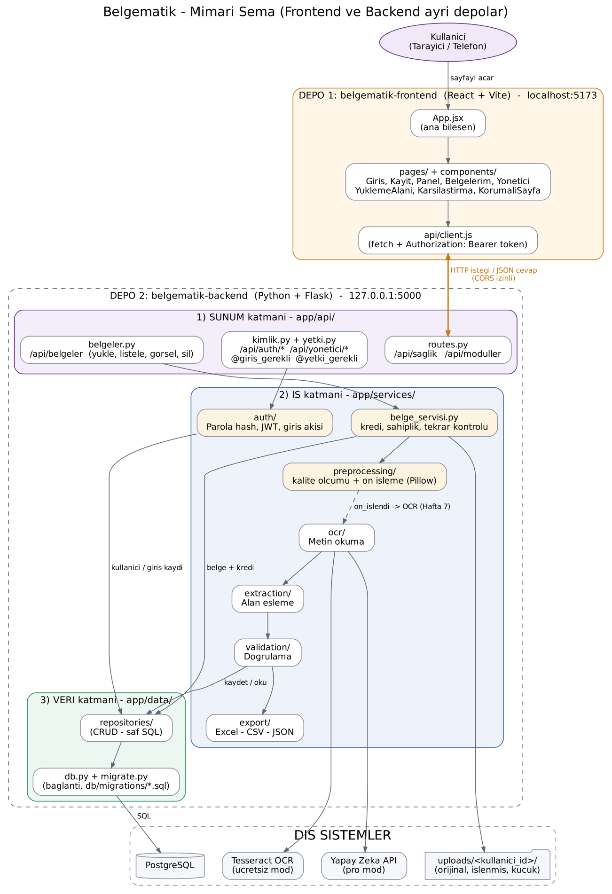

# Belgematik – Backend (API)

**Fiş, fatura ve kartvizit fotoğraflarından yapılandırılmış veri (JSON / tablo) çıkaran uygulamanın backend'i.**

KOBİ'ler ve muhasebeciler her ay yüzlerce belgeyi elle sisteme giriyor. Bu hem yorucu hem de hataya açık.
Belgematik belgenin fotoğrafını alır, OCR ve yapay zekâ ile alanları (firma, vergi no, tarih, KDV, toplam…)
çıkarır, kurallarla doğrular ve sonucu Excel / CSV / JSON olarak verir.

> Proje iki ayrı depodan oluşur:
> - **belgematik-backend** (bu depo): Python + Flask API, iş kuralları, veritabanı
> - **[belgematik-frontend](https://github.com/hasankamiloglu/belgematik-frontend)**: React arayüzü
>
> Durum: **v0.5 – Fotoğraf yükleme ve ön işleme (Hafta 6)**. Modüller haftalık olarak eklenmektedir.

## API uçları

| Yöntem | Adres | Açıklama |
|---|---|---|
| GET | `/api/` | API hakkında bilgi |
| GET | `/api/saglik` | Sağlık kontrolü (sunucu ayakta mı?) |
| GET | `/api/moduller` | Modüllerin geliştirme durumu |
| POST | `/api/auth/kayit` | Yeni hesap (ad_soyad, email, parola, rol) |
| POST | `/api/auth/giris` | Giriş → JWT token |
| GET | `/api/auth/ben` | Giriş yapan kullanıcı 🔒 |
| POST | `/api/auth/cikis` | Çıkış (token geçersiz olur) 🔒 |
| GET | `/api/yonetici/kullanicilar` | Kullanıcılar + giriş denemeleri 🔒 **sadece yönetici** |
| POST | `/api/belgeler` | Fotoğraf/PDF yükle + ön işle (multipart, alan: `dosya`) 🔒 |
| GET | `/api/belgeler` | Kendi belgelerim + kalan kredi 🔒 |
| GET | `/api/belgeler/<id>` | Tek belge (sadece sahibi) 🔒 |
| GET | `/api/belgeler/<id>/gorsel?tur=orijinal\|islenmis\|kucuk` | Görsel dosyası 🔒 |
| DELETE | `/api/belgeler/<id>` | Belgeyi ve dosyalarını sil 🔒 |

🔒 = `Authorization: Bearer <token>` başlığı gerekir. Güvenlik ayrıntıları: [docs/guvenlik-notu.md](docs/guvenlik-notu.md) · Yükleme/ön işleme: [docs/on-isleme.md](docs/on-isleme.md)

## Özellikler (yol haritası)

| Modül | Açıklama | Durum |
|---|---|---|
| Proje iskeleti | Katmanlı mimari, API, CORS, testler | ✅ Hafta 3 |
| Veritabanı | PostgreSQL tabloları, kısıtlar, indeksler, CRUD | ✅ Hafta 4 |
| Kimlik doğrulama | Kayıt/giriş, parola hash, JWT, rol tabanlı erişim | ✅ Hafta 5 |
| Fotoğraf yükleme | PNG / JPG / PDF yükleme, kalite ölçümü, ön işleme | ✅ Hafta 6 |
| OCR | Tesseract (ücretsiz) + Yapay zekâ (pro) | ⏳ |
| Alan eşleme ve doğrulama | Şema ve iş kuralı kontrolü | ⏳ |
| Düzeltme | Hatalı alanları düzeltme API'si | ⏳ |
| Dışa aktarma | Excel, CSV, JSON | ⏳ |

## Teknolojiler

Python · Flask · PostgreSQL (psycopg, saf SQL + migration) · PyJWT · Pillow · Tesseract OCR · Görsel destekli LLM API · Pydantic · pytest · Git/GitHub

## Mimari



Backend **3 katmanlı mimari** ile geliştirilmektedir:

```
app/
├── api/            # 1) SUNUM katmanı : API uçları, JSON cevaplar
├── services/       # 2) İŞ katmanı    : OCR, alan eşleme, doğrulama, dışa aktarma
│   ├── auth/           # parola hash, JWT, giriş akışı (Hafta 5)
│   ├── preprocessing/  # görsel doğrulama, kalite, ön işleme (Hafta 6)
│   ├── belge_servisi.py# yükleme iş kuralları: kredi, sahiplik, tekrar (Hafta 6)
│   ├── ocr/
│   ├── extraction/
│   ├── validation/
│   └── export/
└── data/           # 3) VERİ katmanı  : Veritabanı modelleri ve veri erişimi
    ├── db.py           # bağlantı
    ├── migrate.py      # migration aracı
    └── repositories/   # CRUD (saf SQL)
```

## Veri modeli (ER diyagramı)


Tabloların ve ilişkilerin açıklaması: [docs/veri-modeli.md](docs/veri-modeli.md) · Veritabanı ayrıntıları: [docs/veritabani.md](docs/veritabani.md)

## Kurulum (Windows)

```powershell
git clone https://github.com/hasankamiloglu/belgematik-backend.git
cd belgematik-backend
py -m venv venv
venv\Scripts\activate
pip install -r requirements.txt
copy .env.example .env          # sonra .env içindeki DATABASE_URL şifresini düzenleyin
python manage.py migrate        # tabloları oluşturur
python manage.py seed           # sentetik örnek veriyi yükler
python run.py
```

Önce PostgreSQL kurulu olmalı ve pgAdmin'de `belgematik` adında boş bir veritabanı oluşturulmalı.

Kontrol: http://127.0.0.1:5000/api/saglik

Örnek hesaplar (sadece geliştirme, parola `Deneme123`): `yonetici@ornek.test` (yönetici), `bireysel@ornek.test`, `kobi@ornek.test`, `muhasebeci@ornek.test`.
Bir hesabı yönetici yapmak için: `python manage.py yonetici EMAIL`

Testleri çalıştırmak için: `pytest`  ·  CRUD demosu: `python manage.py demo`

Ekranları görmek için frontend'i de çalıştırın: [belgematik-frontend](https://github.com/hasankamiloglu/belgematik-frontend)

## Klasör yapısı

```
belgematik-backend/
├── app/               # Uygulama kodu (3 katman)
├── db/                # SQL: migrations/ (şema), seed/ (örnek veri), sorgular/
├── tests/             # Otomatik testler
├── uploads/           # Yüklenen belgeler: uploads/<kullanici_id>/ (Git'e gitmez)
├── docs/              # Diyagramlar, kurulum ve haftalık raporlar
├── config.py          # Ortam ayarları (geliştirme / test / canlı) ve CORS
├── run.py             # API'yi başlatan dosya
├── manage.py          # Komutlar: migrate, seed, sorgular, demo, yonetici
├── requirements.txt   # Python kütüphaneleri
├── .env.example       # Örnek gizli ayar dosyası
└── .gitignore         # Git'e gönderilmeyecek dosyalar
```

## Lisans

Bu proje Bilgisayar Uygulamaları I dersi kapsamında geliştirilmektedir.
